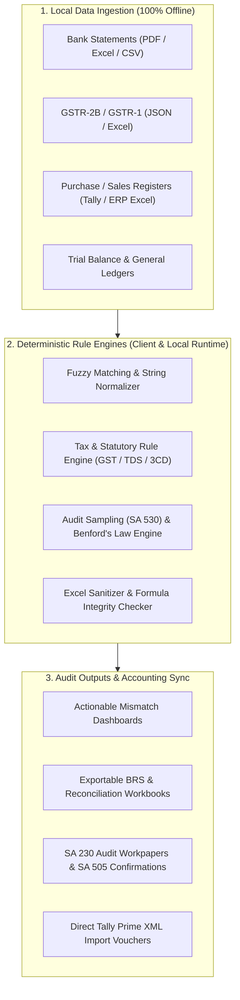

<div align="center">


# CA Copilot
### **Intelligent, Offline-First Audit & Tax Automation Suite for Chartered Accountants**

[](LICENSE)
[](#-getting-started)
[](#-data-privacy--security-first)
[](https://www.typescriptlang.org/)
[](https://react.dev/)
[](https://vitejs.dev/)
[](https://tailwindcss.com/)
[](https://www.electronjs.org/)

<p align="center">
  <b>A high-performance desktop workstation engineered specifically for Indian Chartered Accountants, Statutory Auditors, Tax Consultants, CFOs, and Accounting Firms.</b><br />
  Accelerate complex statutory audits, GSTR-2B reconciliations, Bank BRS, Form 3CD tax audits, Benford's Law anomaly detection, and Tally XML generation from days to seconds.
</p>

[Key Highlights](#-key-highlights) • [Why CA Copilot](#-why-ca-copilot-vs-alternatives) • [Architecture](#-architecture--how-it-works) • [Modules Suite](#-comprehensive-module-breakdown) • [Compliance Standards](#-statutory-compliance--audit-standards) • [Getting Started](#-getting-started) • [Contributing](#-contributing)

---

</div>

## 🌟 Key Highlights

- **🔒 100% Offline-First & Zero Telemetry**: Client financial records, ledgers, and PAN/GST identities never leave your local machine. Fully compliant with client confidentiality mandates under the **ICAI Code of Ethics**.
- **⚡ High-Speed In-Memory Streaming**: Reconciles and pairs 100,000+ transaction lines in under 3 seconds without freezing or hanging like spreadsheet macros.
- **🎯 Indian Statutory Precision**: Purpose-built for Indian Tax & Corporate Law: GSTR-2B / 2A / 3B, TDS/TCS u/s 206AB, Form 3CD Clauses (40A(3), 43B(h), 269SS/T), and Companies Act 2013 Depreciation Schedule II vs Income Tax Act Sec 32.
- **💼 Native Tally Prime Integration**: Automatically generates schema-compliant Tally XML vouchers (`<TALLYMESSAGE>`) ready for 1-click import into **Tally Prime** & **Tally.ERP 9**.
- **📄 Audit-Ready Documentation (SA 230 / SA 505)**: Generates printable, standardized ICAI-compliant working papers, external debtor/creditor balance confirmation letters, and sampling audit trails.
- **🖥️ Dual Deployment**: Available as a native **Windows Desktop Application** (`.exe` installer with frameless titlebar) or a standalone **Local Web App**.

---

## ⚖️ Why CA Copilot vs Alternatives?

| Dimension | Traditional Excel & Macros | Generic Cloud SaaS | ⚡ CA Copilot |
|---|---|---|---|
| **Client Data Privacy** | Prone to accidental leaks & macro malware | Uploaded to third-party public cloud servers | **100% Local In-Memory Sandbox (Zero Cloud)** |
| **Indian Tax Law Built-in** | Fragile formulas; manual updates needed | Generic US GAAP / IFRS rules | **Engineered for GST, 43B(h), 40A(3), Form 3CD, 206AB** |
| **Large Dataset Capacity** | Freezes / crashes above 50,000 rows | Upload timeouts & bandwidth caps | **Optimized streaming engine processes 100k+ rows in seconds** |
| **Tally Prime Integration** | Manual re-entry of reconciled entries | Paid third-party middleware | **Direct `<TALLYMESSAGE>` XML voucher generator** |
| **Fraud & Anomaly Scrutiny**| Manual visual checks | Basic duplicate checks | **Benford's Law digit scrutiny, round-sum & weekend flags** |
| **Audit Documentation** | Ad-hoc unstandardized workpapers | Generic PDF export | **ICAI SA 230 Workpapers & SA 505 Confirmations** |
| **Licensing & Cost** | Costly MS Office licenses | Expensive monthly per-client SaaS fees | **Free & Open Source (MIT License)** |

---

## 🏗️ Architecture & How It Works

CA Copilot operates on an **in-memory streaming and deterministic rule engine** that parses heterogeneous financial records, standardizes erratic formats, applies statutory validation rules, and produces verified audit workpapers.



### Core Processing Flow:
1. **Ingestion & Sanitization**: Files are parsed via local memory buffers (`xlsx`, `pdfjs-dist`). Cell headers, varying date formats (`DD/MM/YYYY`, `MM/DD/YYYY`, serial dates), invisible whitespace, and empty rows are automatically harmonized.
2. **Algorithmic Matching & Scrutiny**:
   - **Document Identification**: Normalized invoice numbers are stripped of prefixes, punctuation, and leading zeroes (`INV/2026/0045` matches `45` and `INV-45`).
   - **Tolerance Thresholds**: Smart matching engine supports user-defined tolerances (₹1 difference, date-window allowance, fuzzy narration similarity).
   - **Compliance Logic**: Applies statutory rules like Section 40A(3) cash ceilings, Section 43B delayed payments, Section 43B(h) MSME 45-day rules, and Section 206AB higher TDS rates.
3. **Structured Verification & Export**: Generates color-coded reconciliation reports, audit trail summaries, and Tally XML vouchers ready for accounting deployment.

---

## 🛠️ Comprehensive Module Breakdown

### 1. GST Reconciliation Suite
- **GSTR-2B vs Purchase Register (Books)**: Matches Input Tax Credit (ITC) at invoice-level. Instantly classifies records into:
  - *Matched Records (Ready for 3B claim)*
  - *ITC Ineligible u/s 17(5) (Motor vehicles, food/beverage, personal consumption)*
  - *Values Mismatch (Taxable / CGST / SGST / IGST discrepancies)*
  - *Missing in GSTR-2B (Potential supplier non-filing / non-compliance)*
  - *Missing in Books (Unclaimed ITC / unbooked purchases)*
- **GST Triple Reconciliation**: Cross-reconciles GSTR-2B, Books of Accounts, and GSTR-3B monthly filings with e-Way Bill tracking.

### 2. Bank Reconciliation (BRS) Engine
- **Automated Statement vs Ledger Matching**: Auto-pairs deposits, withdrawals, cheques, and NEFT/RTGS/UPI transfers.
- **Narration Intelligence**: Extracts reference numbers, UTR numbers, and party names from messy bank statement narrations.
- **Discrepancy Identification**: Automatically isolates uncredited deposits, unpresented cheques, direct bank debits, bank charges, and timing differences.
- **Auto-Generate Contra & Bank Charge Entries**: 1-click export of missing bank entries to Tally XML.

### 3. Statutory & Tax Audit Automation (Form 3CD & Standards on Auditing)
- **Form 3CD Scrutiny Engine**:
  - **Clause 21(a)**: Penalties, fines, and personal expenditures.
  - **Clause 21(d) / Sec 40A(3)**: Cash payments exceeding ₹10,000 per day (or ₹35,000 for transport operators).
  - **Clause 26 / Sec 43B & 43B(h)**: Statutory dues (GST, EPF, ESIC, Bonus) and MSME payments delayed beyond stipulated agreements.
  - **Clause 31 / Sec 269SS & 269T**: Cash acceptance or repayment of loans & deposits ≥ ₹20,000.
  - **Section 206AB**: Higher rate deduction verification for non-filers of ITR.
- **Audit Sampling (SA 530)**: Monetary Unit Sampling (MUS), Stratified Sampling, and Systematic Sampling for statutory sample size calculation.
- **Benford's Law Digit Analysis**: Evaluates leading digit distributions across large journal entry datasets to flag fabricated, split, or manipulated transactions.
- **Audit Workpapers (SA 230)**: Generates standardized, audit-ready workpaper documentation with auditor sign-off stamps.
- **External Balance Confirmations (SA 505)**: Automated bulk generation of ledger balance confirmation letters for debtors and creditors with positive/negative confirmation templates.

### 4. Depreciation & Fixed Asset Register (FAR)
- Computes dual depreciation schedules:
  - **Companies Act, 2013 (Schedule II)**: Useful life-based calculation (WDV and SLM) with residual value capping.
  - **Income Tax Act, 1961 (Section 32)**: Block of assets method with automated 180-day rule check (<180 days 50% depreciation) and Additional Depreciation u/s 32(1)(iia).
- Generates deferred tax asset/liability (DTA/DTL) timing difference statements.

### 5. TDS & TCS Reconciliation
- Matches **Form 26AS / AIS / TIS** against internal TDS books.
- Identifies lower deductions, section misclassifications (194C vs 194J), PAN invalidities, and unclaimed TDS credits.

### 6. Excel & Document Engineering Tools
- **Formula Integrity Checker**: Detects broken links, circular references, `#REF!`, `#VALUE!`, `#NAME?`, and hardcoded constants hidden inside calculation chains.
- **Corrupted Spreadsheet Cleaner**: Repairs corrupt cell formatting, strips invisible trailing characters, and standardizes date representations.
- **Offline PDF to Structured Excel**: Client-side OCR and text parser converts complex bank statement and invoice PDFs into clean multi-column Excel workbooks without uploading files online.
- **Tally XML Voucher Generator**: Converts Excel invoices, journal entries, and bank charges directly into Tally-ready XML vouchers.

---

## 📜 Statutory Compliance & Audit Standards

CA Copilot algorithms are built strictly aligned with official regulatory standards:

| Authority / Statute | Section / Standard | Coverage in CA Copilot |
|---|---|---|
| **ICAI Standards on Auditing** | **SA 230** | Audit Documentation & Workpaper Lead Schedules |
| **ICAI Standards on Auditing** | **SA 500 & SA 505** | Audit Evidence & External Balance Confirmations |
| **ICAI Standards on Auditing** | **SA 520** | Analytical Procedures & Ratio Trend Analysis |
| **ICAI Standards on Auditing** | **SA 530** | Audit Sampling (Monetary Unit & Stratified) |
| **Income Tax Act, 1961** | **Section 32 & 43(6)** | Depreciation Block of Assets & 180-Day Rule |
| **Income Tax Act, 1961** | **Section 40A(3)** | Cash Payment Ceiling (> ₹10,000/day) |
| **Income Tax Act, 1961** | **Section 43B & 43B(h)** | Statutory Dues & MSME 45-Day Payment Scrutiny |
| **Income Tax Act, 1961** | **Section 269SS / 269T**| Cash Loans & Deposits Acceptance / Repayment |
| **Central GST Act, 2017** | **Section 16 & 17(5)** | Input Tax Credit Eligibility & Blocked Credit Scrutiny |
| **Companies Act, 2013** | **Schedule II** | Useful Life-based Depreciation & Residual Value |

---

## 💻 Tech Stack

| Layer | Technologies |
|---|---|
| **Frontend Framework** | React 19, TypeScript, Vite 8 |
| **Desktop Runtime** | Electron (Windows Frameless Titlebar with Window Controls Overlay) |
| **Styling & Design System** | Tailwind CSS (Strict custom CA palette, zero clutter), Lucide Icons |
| **Spreadsheet & PDF Processing**| SheetJS (`xlsx`), `pdfjs-dist`, `jszip` (All running client-side) |
| **Local Backend / Workers** | Node.js, Express 5, TypeScript (`tsx`) |
| **Linter & Code Quality** | Oxlint (High-performance Rust-based linter) |
| **Installer Packaging** | NSIS (`electron-builder`) |

---

## 🔒 Data Privacy & Security First

> [!IMPORTANT]
> **Zero Telemetry. Zero Cloud Ingestion.**
> Chartered Accountants handle non-public financial information, audit trail records, and PAN/GST identities. CA Copilot is engineered with a strict **Local Sandbox Principle**:
> - Files selected or dropped into the application are loaded into browser memory buffers.
> - No transaction data, financial ledger, or PAN number is transmitted to external servers.
> - Safe for offline workstations, air-gapped systems, and secure audit rooms.

---

## 🚀 Getting Started

### Option A: Windows Desktop Application (Recommended)

1. Download the latest installer from the Releases page: `CA Copilot Setup 1.0.0.exe`.
2. Run the installer and choose your installation directory.
3. Launch **CA Copilot** directly from your Desktop or Start Menu.

---

### Option B: Run from Source

#### Prerequisites
- **Node.js**: `v20.0.0` or higher recommended
- **npm**: `v10.0.0` or higher

#### 1. Clone the repository:
```bash
git clone https://github.com/your-username/ca-automation.git
cd ca-automation
```

#### 2. Install dependencies:
```bash
npm install
```

#### 3. Start the Web App:
```bash
npm run dev
```
Open [http://localhost:5173](http://localhost:5173) in your browser.

#### 4. Run Desktop App in Development Mode:
```bash
npm run electron:dev
```

#### 5. Build Desktop Installer (`.exe`):
```bash
npm run build:desktop
```
The compiled installer will be generated in `./setup-dist/CA Copilot Setup 1.0.0.exe`.

---

## 🧪 Testing & Quality Assurance

CA Copilot includes a rigorous automated test suite covering mathematical accuracy, tax rule boundary checks, and export schema compliance:

```bash
# Run client reconciliation engine unit tests
npm test

# Run backend statutory logic and integrity tests
npm run test:backend

# Run all test suites in one command
npm run test:all

# Run high-speed linting
npm run lint
```

---

## 📁 Directory Structure

```text
ca-automation/
├── electron/                   # Electron desktop integration & frameless window setup
├── public/                     # Static assets (icon.ico, logo.png, logo-square.png)
├── server/                     # Local backend services & statutory test suites
│   ├── routes/                 # Local API endpoints
│   ├── services/               # Workflow orchestrator, anomaly detection, Form 3CD service
│   └── tests/                  # Automated backend & engine unit tests
├── src/
│   ├── assets/                 # Brand assets & bundled images
│   ├── components/
│   │   ├── audit/              # Audit checklists, sampling, and workpaper views
│   │   ├── automation/         # Workflow Orchestrator & Workflow Map
│   │   ├── bank/               # Bank Reconciliation (BRS) views
│   │   ├── common/             # Frameless titlebar, Sidebar, BrandLogo, Toasts
│   │   ├── gst/                # GSTR-2B & Triple Rec components
│   │   ├── invoice/            # Invoice processing & data extraction views
│   │   ├── pdf/                # PDF to Excel table extraction views
│   │   ├── settings/           # Offline tools and system settings
│   └── tools/                  # 35+ specialized standalone CA utility tools
│   ├── utils/                  # Core deterministic reconciliation & statutory math engines
│   ├── App.tsx                 # Main application controller
│   └── main.tsx                # React application entry point
├── package.json
└── vite.config.ts
```

---

## 🤝 Contributing

Contributions are welcome! If you are a Chartered Accountant, Tax Auditor, or Full-Stack Developer:
1. Fork the Project
2. Create your Feature Branch (`git checkout -b feature/NewAuditEngine`)
3. Commit your Changes (`git commit -m 'Add support for 43B(h) MSME compliance'`)
4. Push to the Branch (`git push origin feature/NewAuditEngine`)
5. Open a Pull Request

---

## 📄 License

This project is licensed under the [MIT License](LICENSE).

<div align="center">
  <sub>Built with ❤️ for Chartered Accountants, Tax Auditors, and Finance Professionals.</sub>
</div>
